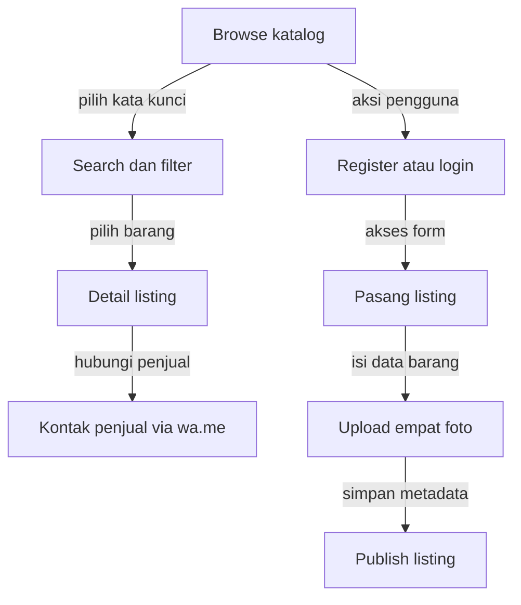
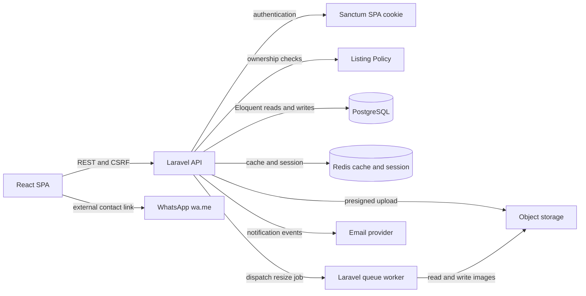
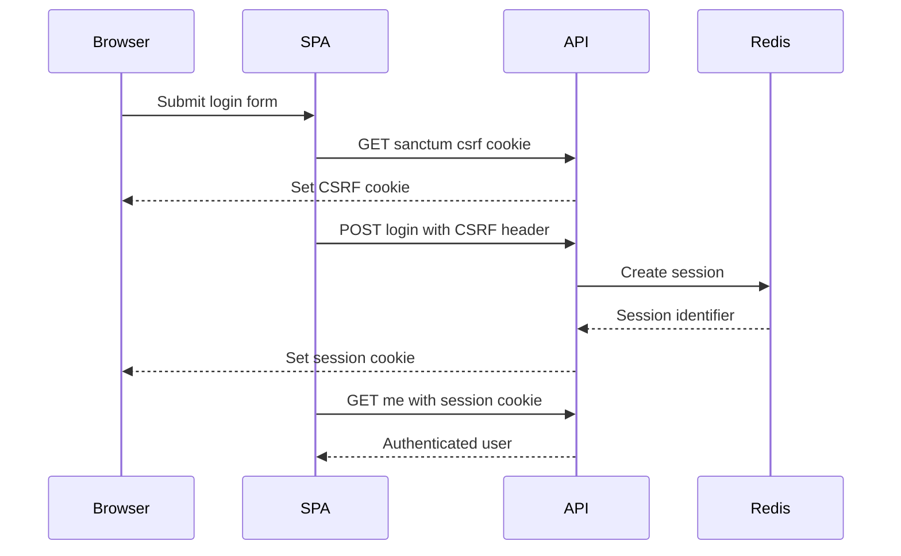
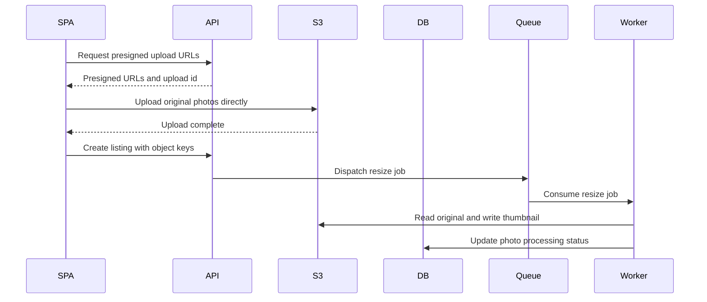

# Arsitektur Aplikasi LaPak.

Dokumen ini mendeskripsikan target arsitektur aplikasi untuk skala 100K DAU.
Angka kapasitas adalah baseline desain, bukan klaim kapasitas environment lokal.

## Status Implementasi

| Komponen | Status |
|---|---|
| SPA auth, Policy, Form Request, auth/catalog rate limit, index DB | Sudah diimplementasi |
| Upload foto | Lokal melalui `Storage::disk('public')` (dummy), target: presigned URL ke S3 |
| Redis, CDN, queue resize, read replica, email notification | Rancangan |
| `pg_trgm` + GIN index untuk search | Rancangan; saat ini search memakai `ILIKE` |
| Pagination | Saat ini offset pagination melalui Eloquent `paginate()`; cursor pagination adalah rencana |

## Asumsi dan Hitungan Kapasitas

| Asumsi | Nilai |
|---|---:|
| Pengguna aktif harian | 100.000 DAU |
| Request per pengguna per hari | 30 |
| Rasio read:write | 95:5 |
| Pengguna yang memasang listing per hari | 2% DAU |
| Foto per listing | 4 |
| Ukuran rata-rata per foto | 330 KB |
| Target desain aplikasi | 500 RPS |

| Hitungan | Hasil |
|---|---:|
| Request harian | 100.000 x 30 = 3.000.000 request/hari |
| RPS rata-rata | 3.000.000 / 86.400 = 34,7, dibulatkan ~35 RPS |
| Peak 10x | 35 x 10 = ~350 RPS |
| Write harian | 3.000.000 x 5% = 150.000 write/hari |
| Listing baru harian | 100.000 x 2% = 2.000 listing/hari |
| Data foto harian | 2.000 x 4 x 330 KB = 2.640.000 KB, sekitar 2,6 GB/hari |
| Data foto tahunan | 2,6 GB x 365 = sekitar 1 TB/tahun |
| Bandwidth gambar (egress/download) | 3 MB/user/hari, 100.000 x 3 MB = sekitar 300 GB/hari, dilayani CDN |
| Peak bandwidth foto | sekitar 300 Mbps, dilayani melalui CDN |

## 1. User Flow

Keputusan: WhatsApp memakai deep link `wa.me` dengan pesan awal, bukan chat internal.
Alternatifnya adalah membangun messaging service sendiri. Trade-off-nya adalah UX
lebih sederhana dan biaya rendah, tetapi percakapan serta delivery status berada di
luar sistem.

## 2. Component Diagram

Worker dan Email provider pada diagram adalah komponen **rencana**; implementasi
saat ini belum menjalankan queue resize maupun email notification.

### Technology Stack

| Layer | Teknologi | Peran |
|---|---|---|
| UI | React, Vite, TypeScript, Tailwind, React Router | SPA katalog dan form |
| API | Laravel `^13.17`, PHP `^8.3` | REST API, validation, resources |
| Auth | Laravel Sanctum SPA cookie/session | Session web dan CSRF |
| Authorization | Laravel Policy | Ownership listing |
| Database | PostgreSQL | Data transaksi dan katalog |
| Cache/session | Redis | Cache listing, session, rate limiter |
| Storage | S3-compatible object storage | Original dan thumbnail foto |
| Async | Laravel Queue worker | Resize, re-encode, email |
| Edge | CDN dan WAF | TLS termination, caching, protection |

### Data Storage dan External Service

PostgreSQL menjadi source of truth untuk user, kategori, listing, dan metadata
foto. Redis menyimpan cache read-heavy serta session saat deployment horizontal.
Object storage menyimpan binary foto sehingga API tidak menjadi bottleneck.
Email dipakai untuk notifikasi yang tidak harus synchronous, sementara WhatsApp
tetap berupa link eksternal tanpa menyimpan isi chat.

Redis menyimpan session SPA sehingga deployment production harus memakai Redis
Multi-AZ dengan replica dan failover otomatis. Jika Redis down, cache dapat
fallback ke PostgreSQL, tetapi session dapat tidak tersedia dan pengguna bisa
ter-logout; Redis tidak boleh diperlakukan sebagai dependency single-instance.

## 3. Sequence Diagram

### Login SPA

### Rancangan Target Upload Foto dan Resize

Implementasi saat ini masih memakai multipart upload ke Laravel dan local
filesystem melalui `Storage::disk('public')`. Presigned URL dipilih sebagai
target untuk menghindari streaming binary melalui Laravel API. Trade-off-nya,
presigned upload membutuhkan lifecycle object dan status processing, tetapi
mengurangi beban CPU, memory, dan bandwidth application tier.

## 4. Caching, Indexing, dan Pagination

### Caching Strategy

| Data | Cache key | TTL | Invalidasi |
|---|---|---:|---|
| Homepage listing | `listings:query:<hash>` | 30 detik | Mengandalkan TTL; tidak ada invalidasi per kombinasi query |
| Detail listing | `listing:<id>` | 60 detik | Hapus saat listing atau foto berubah |
| Kategori | `categories:all` | 10 menit | Hapus saat kategori berubah |
| Session | Laravel session key | 120 menit | Invalidate saat logout |

Cache homepage bersifat best effort dan mengandalkan TTL 30 detik karena key
berbasis hash query memiliki banyak kombinasi. Invalidasi aktif hanya dilakukan
untuk `listing:<id>` dan `categories:all` setelah transaksi database berhasil
commit. Jika Redis tidak tersedia, request read dapat diteruskan ke PostgreSQL,
tetapi session Redis memerlukan failover otomatis sesuai status implementasi di
atas.

### Indexing dan Search

- B-tree pada `listings(category_id, condition, status, created_at)` untuk
  filter dan sort katalog.
- B-tree pada `listings(user_id, created_at)` untuk profil penjual.
- Index `listing_images(listing_id, sort_order)` untuk galeri.
- Implementasi saat ini memakai PostgreSQL `ILIKE` pada `name` dan
  `description`; `pg_trgm` dan GIN trigram index belum dibuat oleh migration.
  Ini adalah rencana optimasi yang layak diterapkan saat latensi search mulai
  meningkat, setelah pola query dan metrik p95 terukur.
- Query memakai eager loading `category`, `user`, dan `images` untuk mencegah N+1.

Keputusan: PostgreSQL `ILIKE` dipakai untuk MVP, dengan `pg_trgm` + GIN sebagai
rencana optimasi saat latensi search naik. Alternatif berikutnya adalah
Elasticsearch/OpenSearch. PostgreSQL lebih sederhana, sedangkan search engine
memberi relevance dan scale lebih besar dengan biaya operasional serta
sinkronisasi tambahan.

### Pagination

Implementasi saat ini menggunakan offset pagination melalui Eloquent `paginate()`.
Default `per_page` 12, maksimum 50, dan sort stabil memakai `created_at` lalu `id`.
Cursor pagination untuk feed yang terus berubah adalah rencana pengembangan.

## 5. Security

| Area | Kontrol |
|---|---|
| Authentication | Sanctum SPA cookie/session, CSRF cookie, password hash bawaan |
| Authorization | `ListingPolicy`: hanya owner boleh update, delete, ubah status |
| Input validation | Form Request untuk semua endpoint; allowlist enum dan field |
| Rate limiting | Auth 10/menit; katalog 60/menit; protected mutation route saat ini memakai `auth:sanctum` tanpa throttle dedicated |
| CORS dan CSRF | Origin eksplisit dari `FRONTEND_URL`, credentials aktif, CSRF header |
| Secret management | `.env` lokal; production secret manager, bukan repository |
| Encryption | TLS di edge dan encryption at rest untuk database, Redis, object storage |
| File upload | Validasi MIME dan ukuran, batas jumlah file, random object key |
| Image safety | Re-encode dengan image library, strip metadata, buat thumbnail server-side |
| Access control | Bucket private; URL download/upload berumur pendek; CDN signed URL bila perlu |

## 6. Keputusan Utama dan Trade-off

| Pilihan | Alternatif | Trade-off |
|---|---|---|
| Laravel API stateless di application container | Server-rendered monolith | SPA memberi UX interaktif, tetapi membutuhkan CORS dan deployment terpisah |
| Sanctum SPA cookie/session | Bearer token di localStorage | Cookie lebih aman untuk first-party SPA, tetapi perlu CSRF dan stateful domain |
| PostgreSQL sebagai source of truth | NoSQL database | Relasi dan transaksi lebih sederhana di PostgreSQL; scale write perlu replica dan tuning |
| Redis untuk cache/session | Database session saja | Redis cepat dan horizontal-friendly, tetapi menambah dependency |
| S3 plus CDN | Local filesystem | Durable dan scalable; biaya storage/egress perlu dikontrol |
| Queue untuk resize/email | Synchronous processing | Request cepat dan retry tersedia; UX perlu status processing |
