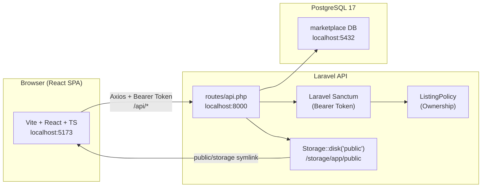
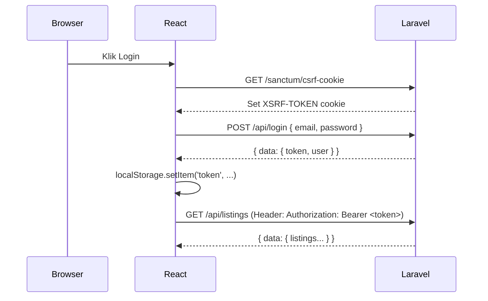
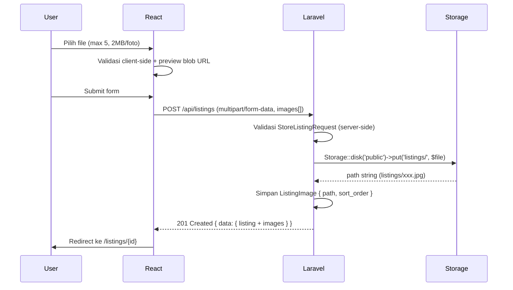

# Arsitektur Sistem – Marketplace Bapak-Bapak

> Dokumen ini menjelaskan keputusan arsitektur tingkat tinggi, struktur proyek, dan alur data sistem.

---

## 1. Gambaran Arsitektur



---

## 2. Tech Stack

| Layer | Teknologi | Versi | Alasan |
|-------|-----------|-------|--------|
| Frontend | React + Vite + TypeScript | React 19 / Vite 6 | SPA cepat, type-safety, ekosistem besar |
| Styling | Tailwind CSS v4 | 4.x | Utility-first, mobile-first, zero config |
| HTTP Client | Axios | 1.x | Interceptor, error handling, multipart |
| Routing | React Router DOM | v7 | File-based routing SPA |
| Backend | Laravel | 13.x (Framework 11) | Laravel ekosistem lengkap: Eloquent, Policy, Form Request |
| Auth | Laravel Sanctum | bundled | SPA Auth via Bearer Token (stateless JSON API) |
| Database | PostgreSQL | 17.4 | ILIKE search, enum types, production-grade |
| File Storage | Laravel Storage (public disk) | bundled | Abstraksi path, mudah migrasi ke S3 |
| State Icons | Lucide React | 0.x | Icon set modern, tree-shakeable |

---

## 3. Struktur Folder

### Backend (`/backend`)

```
backend/
├── app/
│   ├── Http/
│   │   ├── Controllers/Api/
│   │   │   ├── AuthController.php        # register, login, logout, me
│   │   │   ├── ListingController.php     # CRUD + status + userListings
│   │   │   └── CategoryController.php   # index dengan listings_count
│   │   ├── Requests/
│   │   │   ├── Auth/
│   │   │   │   ├── RegisterRequest.php
│   │   │   │   ├── LoginRequest.php
│   │   │   │   └── UpdateProfileRequest.php
│   │   │   └── Listing/
│   │   │       ├── StoreListingRequest.php   # validasi + max 5 foto 2MB
│   │   │       ├── UpdateListingRequest.php
│   │   │       └── UpdateListingStatusRequest.php
│   │   └── Resources/
│   │       ├── UserResource.php     # full user (email included, untuk /me)
│   │       ├── SellerResource.php   # subset: id, name, whatsapp, location ONLY
│   │       ├── CategoryResource.php
│   │       └── ListingResource.php  # nesting SellerResource + images URL
│   ├── Models/
│   │   ├── User.php          # HasMany listings
│   │   ├── Category.php      # HasMany listings
│   │   ├── Listing.php       # BelongsTo user, category; HasMany images
│   │   └── ListingImage.php  # BelongsTo listing
│   ├── Policies/
│   │   └── ListingPolicy.php  # update, delete, updateStatus → owner only
│   └── Traits/
│       └── ApiResponse.php    # error() helper → { error: { code, message } }
├── database/
│   ├── factories/   # UserFactory, CategoryFactory, ListingFactory, ListingImageFactory
│   ├── migrations/  # 4 migration files
│   └── seeders/     # UserSeeder, CategorySeeder, ListingSeeder, DatabaseSeeder
├── routes/
│   └── api.php      # semua API routes dengan throttle + auth:sanctum middleware
├── storage/app/public/listings/   # file foto upload
└── public/storage/                # symlink → storage/app/public
```

### Frontend (`/frontend`)

```
frontend/src/
├── api/
│   └── axios.ts          # Axios instance, Bearer Token interceptor, getCsrfCookie()
├── context/
│   └── AuthContext.tsx   # user, login, register, logout, loading, isAuthenticated
├── components/
│   ├── Navbar.tsx         # sticky, responsive, mobile drawer, search, user menu
│   ├── Footer.tsx
│   ├── ProtectedRoute.tsx # ProtectedRoute + GuestRoute HOC
│   ├── ListingCard.tsx    # grid card: foto, nama, harga IDR, badge
│   ├── BadgeStatus.tsx    # Tersedia (emerald) / Terjual (rose)
│   ├── BadgeCondition.tsx # warna per kondisi (Baru/Seperti Baru/Baik/Lumayan)
│   ├── EmptyState.tsx     # ilustrasi + pesan + aksi
│   ├── ErrorState.tsx     # ilustrasi + pesan + retry
│   ├── LoadingSkeleton.tsx # ListingGridSkeleton + ListingDetailSkeleton
│   └── ConfirmModal.tsx   # modal konfirmasi hapus
├── pages/
│   ├── HomePage.tsx           # katalog + search + filter + pagination (URL sync)
│   ├── ListingDetailPage.tsx  # galeri, info penjual, WhatsApp CTA
│   ├── LoginPage.tsx
│   ├── RegisterPage.tsx
│   ├── CreateListingPage.tsx  # multi-foto upload dengan preview
│   ├── EditListingPage.tsx    # load + ownership check + update
│   └── ProfilePage.tsx        # info user + kelola listing (toggle/edit/hapus)
├── types/
│   └── index.ts   # TypeScript types: User, Listing, Category, dll
└── utils/
    ├── format.ts      # formatRupiah, CONDITION_LABELS, STATUS_LABELS, formatDate
    └── whatsapp.ts    # normalizeWhatsAppNumber (08xx→628xx), generateWhatsAppLink
```

---

## 4. Alur Auth (Bearer Token)



> **Catatan**: Aplikasi ini menggunakan **stateless token-based auth** (bukan cookie session). Token Sanctum disimpan di `localStorage` dan dikirim sebagai `Authorization: Bearer <token>` header di setiap request.

---

## 5. Alur Upload Foto



---

## 6. Strategi Error Handling

Semua error API menggunakan format konsisten:

```json
{
  "error": {
    "code": "VALIDATION_ERROR",
    "message": "Data yang diberikan tidak valid.",
    "details": {
      "name": ["Nama barang wajib diisi."],
      "images.0": ["File gambar tidak boleh lebih dari 2MB."]
    }
  }
}
```

| HTTP Code | Code String | Trigger |
|-----------|-------------|---------|
| 422 | `VALIDATION_ERROR` | Form Request gagal validasi |
| 401 | `UNAUTHENTICATED` | Tidak ada / token expired |
| 403 | `FORBIDDEN` | Bukan owner listing |
| 404 | `NOT_FOUND` | Model tidak ditemukan |
| 429 | `TOO_MANY_REQUESTS` | Throttle limit tercapai |
| 500 | `SERVER_ERROR` | Uncaught exception |

---

## 7. Security

| Aspek | Implementasi |
|-------|-------------|
| **Auth** | Sanctum Bearer Token → header `Authorization: Bearer xxx` |
| **Ownership** | `ListingPolicy` via `$this->authorize()` di controller — tidak manual check |
| **Input Validation** | Semua endpoint pakai **Form Request** (tidak ada validasi ad-hoc di controller) |
| **SQL Injection** | Eloquent query builder + parameter binding — tidak ada raw SQL tanpa binding |
| **File Upload** | Validasi `mimes:jpg,jpeg,png,webp` + `max:2048` KB per file, max 5 file |
| **Rate Limiting** | `throttle:10,1` untuk register/login; `throttle:60,1` untuk public endpoints |
| **CORS** | `config/cors.php`: allowed_origins dari `.env` `FRONTEND_URL`, `supports_credentials: true` |
| **Data Exposure** | `SellerResource` hanya expose `id, name, whatsapp, location` — email & password tidak pernah ada di response publik |
