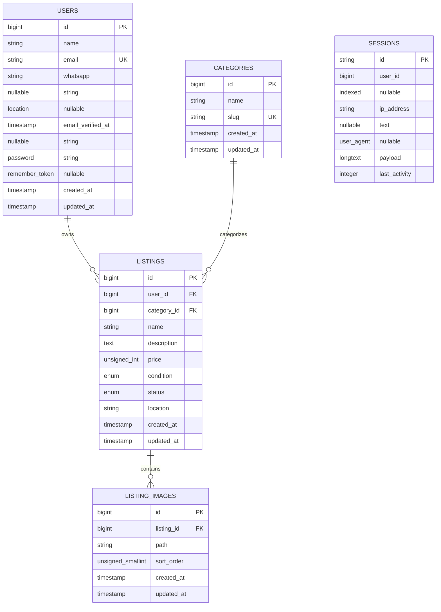

# Dokumentasi Database

Skema berikut diambil dari migration di `backend/database/migrations`.
PostgreSQL adalah driver yang dipakai oleh `.env.example`.

## ERD



`password_reset_tokens`, `cache`, `cache_locks`, `jobs`, `job_batches`,
`failed_jobs`, dan `personal_access_tokens` juga dibuat oleh migration framework.
Tabel tersebut tidak memiliki foreign key aplikasi pada migration yang ada dan
tidak dimasukkan sebagai relasi domain utama pada ERD.

## Tabel Domain

### `users`

Menyimpan akun pembeli sekaligus penjual. `email` unik. `whatsapp` dan
`location` nullable. Password disimpan sebagai hash melalui model User.

### `categories`

Menyimpan `name` dan `slug`; `slug` memiliki unique index.

### `listings`

Kolom:

- `user_id`: owner, foreign key ke `users`, cascade delete.
- `category_id`: foreign key ke `categories`, cascade delete.
- `name`, `description`, `location`: data listing.
- `price`: unsigned integer.
- `condition`: enum `NEW`, `LIKE_NEW`, `GOOD`, `FAIR`.
- `status`: enum `AVAILABLE`, `SOLD`, default `AVAILABLE`.
- `created_at`, `updated_at`: timestamps Laravel.

### `listing_images`

Menyimpan path file atau URL eksternal, bukan binary gambar. `listing_id` cascade delete.
`sort_order` unsigned small integer, default `0`.

### `sessions`

Dipakai oleh `SESSION_DRIVER=database` untuk session cookie Sanctum SPA.
`user_id` nullable karena session dapat belum terasosiasi dengan user.

## Index

| Tabel | Index | Alasan |
|---|---|---|
| `users` | primary `id` | Identitas user |
| `users` | unique `email` | Login dan uniqueness |
| `categories` | primary `id` | Identitas kategori |
| `categories` | unique `slug` | Slug tidak duplikat |
| `listings` | primary `id` | Detail listing |
| `listings` | `category_id` | Filter kategori |
| `listings` | `condition` | Filter kondisi |
| `listings` | `status` | Filter status |
| `listings` | `created_at` | Urutan terbaru |
| `listings` | `(status, created_at)` | Feed status tersedia + urutan |
| `listing_images` | `(listing_id, sort_order)` | Galeri terurut |
| `sessions` | primary `id` | Lookup session |
| `sessions` | `user_id` | Lookup session user |
| `sessions` | `last_activity` | Pembersihan session lama |

Search `ILIKE` pada `name` dan `description` digunakan controller, tetapi
migration saat ini belum membuat index `pg_trgm`.

## Relasi Eloquent

| Model | Relasi | Target |
|---|---|---|
| `User` | `listings()` | `Listing` has many |
| `Category` | `listings()` | `Listing` has many |
| `Listing` | `user()` | `User` belongs to |
| `Listing` | `category()` | `Category` belongs to |
| `Listing` | `images()` | `ListingImage` has many, order `sort_order`, `id` |
| `Listing` | `primaryImage()` | `ListingImage` has one, minimum `sort_order` dan `id` |
| `ListingImage` | `listing()` | `Listing` belongs to |

## Seeder

`DatabaseSeeder` menjalankan `UserSeeder`, `CategorySeeder`, dan
`ListingSeeder`. User utama:

```text
Email: bambang@marketplace.test
Password: password123
```
