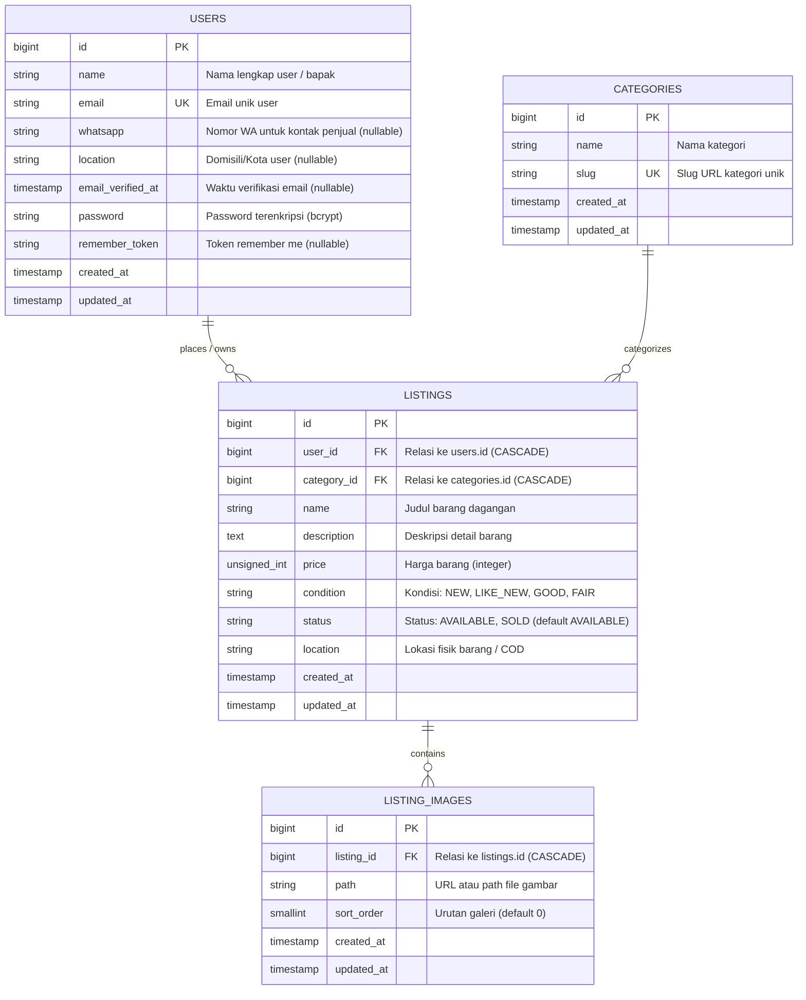

# Dokumentasi Database - Marketplace Bapak-Bapak

Dokumen ini menjelaskan rancangan skema database, Entity Relationship Diagram (ERD), strategi indexing, serta relasi model Eloquent untuk platform Marketplace Secondhand Komunitas Bapak-Bapak.

---

## 1. Entity Relationship Diagram (ERD)

---

## 2. Struktur Tabel & Skema

### Tabel `users`
Menyimpan data akun pengguna (pembeli sekaligus penjual di marketplace).

| Kolom | Tipe | Nullable | Default | Keterangan |
|---|---|---|---|---|
| `id` | `BIGINT` | Tidak | Auto-increment | Primary Key |
| `name` | `VARCHAR(255)` | Tidak | - | Nama pengguna |
| `email` | `VARCHAR(255)` | Tidak | - | Email unik untuk login |
| `whatsapp` | `VARCHAR(255)` | Ya | `NULL` | Nomor kontak WhatsApp (format: 628xxx) |
| `location` | `VARCHAR(255)` | Ya | `NULL` | Kota asal / domisili penjual |
| `email_verified_at` | `TIMESTAMP` | Ya | `NULL` | Waktu verifikasi email |
| `password` | `VARCHAR(255)` | Tidak | - | Hash password (bawaan Laravel) |
| `remember_token` | `VARCHAR(100)` | Ya | `NULL` | Token "ingat saya" |
| `created_at` | `TIMESTAMP` | Ya | `NULL` | Waktu pendaftaran |
| `updated_at` | `TIMESTAMP` | Ya | `NULL` | Waktu pembaruan profil |

- **Indeks**:
  - `users_pkey` (`id` PRIMARY KEY)
  - `users_email_unique` (`email` UNIQUE)

---

### Tabel `categories`
Menyimpan daftar kategori minat barang bapak-bapak (misal: Perkakas, Kopi, Otomotif, Audio Vintage).

| Kolom | Tipe | Nullable | Default | Keterangan |
|---|---|---|---|---|
| `id` | `BIGINT` | Tidak | Auto-increment | Primary Key |
| `name` | `VARCHAR(255)` | Tidak | - | Nama kategori barang |
| `slug` | `VARCHAR(255)` | Tidak | - | Slug URL unik |
| `created_at` | `TIMESTAMP` | Ya | `NULL` | Timestamps |
| `updated_at` | `TIMESTAMP` | Ya | `NULL` | Timestamps |

- **Indeks**:
  - `categories_pkey` (`id` PRIMARY KEY)
  - `categories_slug_unique` (`slug` UNIQUE)

---

### Tabel `listings`
Tabel utama katalog barang secondhand yang dipasarkan.

| Kolom | Tipe | Nullable | Default | Keterangan |
|---|---|---|---|---|
| `id` | `BIGINT` | Tidak | Auto-increment | Primary Key |
| `user_id` | `BIGINT` | Tidak | - | Foreign Key ke `users.id` (ON DELETE CASCADE) |
| `category_id` | `BIGINT` | Tidak | - | Foreign Key ke `categories.id` (ON DELETE CASCADE) |
| `name` | `VARCHAR(255)` | Tidak | - | Nama / judul barang |
| `description` | `TEXT` | Tidak | - | Deskripsi spesifikasi dan kondisi barang |
| `price` | `INTEGER` | Tidak | - | Harga dalam Rupiah (unsigned) |
| `condition` | `VARCHAR(255)` | Tidak | - | `NEW`, `LIKE_NEW`, `GOOD`, `FAIR` |
| `status` | `VARCHAR(255)` | Tidak | `'AVAILABLE'` | `AVAILABLE`, `SOLD` |
| `location` | `VARCHAR(255)` | Tidak | - | Lokasi barang (kota/wilayah) |
| `created_at` | `TIMESTAMP` | Ya | `NULL` | Waktu listing dibuat |
| `updated_at` | `TIMESTAMP` | Ya | `NULL` | Waktu listing diperbarui |

- **Indeks & Strategi Performa**:
  - `listings_pkey`: Primary key pada kolom `id`.
  - `listings_category_id_index`: B-Tree index untuk filter barang berdasarkan kategori.
  - `listings_condition_index`: B-Tree index untuk filter kondisi barang.
  - `listings_status_index`: B-Tree index untuk filter status ketersediaan barang.
  - `listings_created_at_index`: B-Tree index untuk pengurutan barang terbaru.
  - `listings_status_created_at_index`: Compound index (`status, created_at`) untuk optimasi query feed katalog utama (`WHERE status = 'AVAILABLE' ORDER BY created_at DESC`).

---

### Tabel `listing_images`
Menyimpan foto galeri untuk setiap barang listing (1 listing dapat memiliki 1 s.d. banyak gambar).

| Kolom | Tipe | Nullable | Default | Keterangan |
|---|---|---|---|---|
| `id` | `BIGINT` | Tidak | Auto-increment | Primary Key |
| `listing_id` | `BIGINT` | Tidak | - | Foreign Key ke `listings.id` (ON DELETE CASCADE) |
| `path` | `VARCHAR(255)` | Tidak | - | Path file internal (`storage/...`) atau URL gambar eksternal |
| `sort_order` | `SMALLINT` | Tidak | `0` | Urutan penayangan foto (0 = foto sampul) |
| `created_at` | `TIMESTAMP` | Ya | `NULL` | Timestamps |
| `updated_at` | `TIMESTAMP` | Ya | `NULL` | Timestamps |

- **Indeks**:
  - `listing_images_pkey`: Primary key pada kolom `id`.
  - `listing_images_listing_id_sort_order_index`: Compound index (`listing_id, sort_order`) untuk pengambilan galeri yang sudah berurutan secara efisien.

---

## 3. Pemetaan Relasi Eloquent

| Model Asal | Nama Relasi | Tipe Relasi | Model Target | Keterangan |
|---|---|---|---|---|
| `User` | `listings()` | `HasMany` | `Listing` | Mendapatkan semua barang yang dijual oleh user ini. |
| `Category` | `listings()` | `HasMany` | `Listing` | Mendapatkan semua barang dalam kategori ini. |
| `Listing` | `user()` | `BelongsTo` | `User` | Mendapatkan data penjual / pemilik barang. |
| `Listing` | `category()` | `BelongsTo` | `Category` | Mendapatkan kategori barang. |
| `Listing` | `images()` | `HasMany` | `ListingImage` | Galeri foto terurut berdasarkan `sort_order ASC, id ASC`. |
| `Listing` | `primaryImage()` | `HasOne` | `ListingImage` | Mengambil foto utama / sampul (`ofMany` sort_order terendah) tanpa N+1. |
| `ListingImage` | `listing()` | `BelongsTo` | `Listing` | Mendapatkan listing induk dari gambar. |

---

## 4. Seeder & Data Awal

DatabaseSeeder mengeksekusi:
1. `UserSeeder`:
   - 1 akun utama demo:
     - **Email**: `bambang@marketplace.test`
     - **Password**: `password123`
     - **WhatsApp**: `6281234567890`
     - **Lokasi**: Jakarta Selatan
   - 4 akun bapak-bapak lainnya dengan nomor WhatsApp dan domisili realistis (Bandung, Bekasi, Tangerang Selatan, Surabaya).
2. `CategorySeeder`:
   - 8 kategori khas bapak-bapak:
     1. Perkakas & Pertukangan
     2. Otomotif & Sparepart
     3. Hobi Kopi & Barista
     4. Audio & Sound Vintage
     5. Alat Pancing & Outdoor
     6. Elektronik & Gadget Lawas
     7. Aquascape & Tanaman Hias
     8. Jam Tangan & Koleksi Pria
3. `ListingSeeder`:
   - 30 barang dagangan khas dengan nama, deskripsi mendalam, harga variatif, kondisi (`NEW`, `LIKE_NEW`, `GOOD`, `FAIR`), dan status (`AVAILABLE`, `SOLD`).
   - Setiap listing dilengkapi 1 s.d. 3 gambar placeholder resolusi tinggi dengan urutan `sort_order`.
