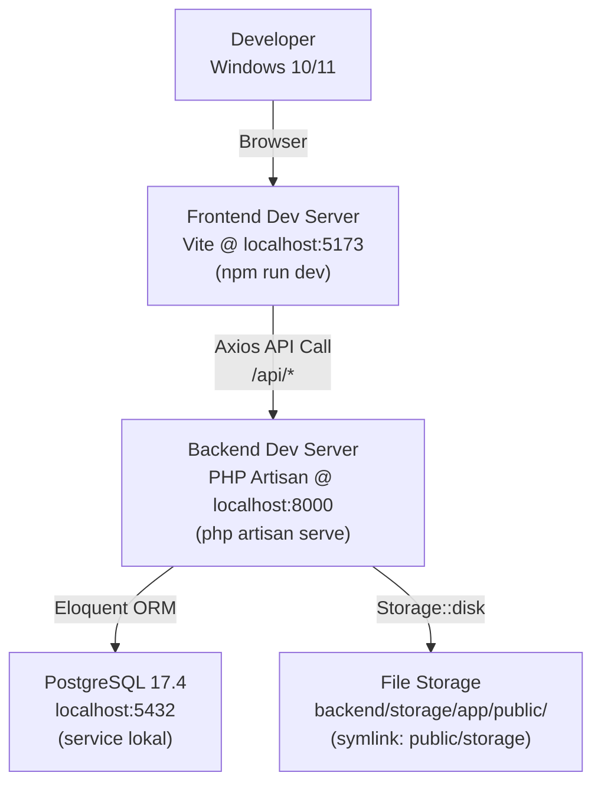
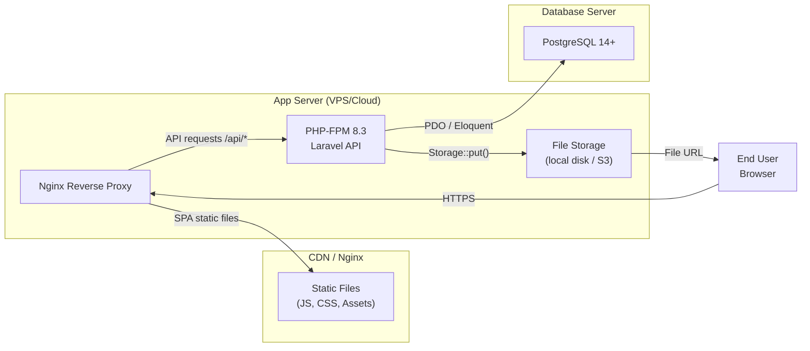

# Infrastructure – Marketplace Bapak-Bapak

Dokumen ini menjelaskan infrastruktur yang digunakan untuk development lokal, arsitektur production yang direkomendasikan, dan konfigurasi environment.

---

## 1. Environment: Development Lokal



### Services yang Diperlukan (Lokal)

| Service | URL / Port | Start Command |
|---------|-----------|--------------|
| PostgreSQL | `localhost:5432` | Otomatis via Windows Service |
| Laravel Backend | `http://localhost:8000` | `cd backend && php artisan serve` |
| Vite Frontend | `http://localhost:5173` | `cd frontend && npm run dev` |

### Docker (Opsional)

`docker-compose.yml` di root project menyediakan PostgreSQL container sebagai alternatif instalasi lokal:

```bash
# Jalankan hanya jika tidak punya PostgreSQL lokal
docker compose up -d postgres
```

> **Catatan**: Docker **tidak wajib** untuk development. PostgreSQL lokal (terinstall langsung) adalah cara utama.

---

## 2. Environment: Production (Rekomendasi)



### Spesifikasi Server Minimum (Production)

| Komponen | Minimum | Rekomendasi |
|----------|---------|-------------|
| CPU | 1 vCPU | 2 vCPU |
| RAM | 1 GB | 2 GB |
| Storage | 20 GB SSD | 50 GB SSD |
| OS | Ubuntu 22.04 LTS | Ubuntu 22.04 LTS |
| PHP | 8.2 | 8.3 |
| PostgreSQL | 14 | 15+ |

### Cloud Provider Options

| Provider | Tier | Estimasi Biaya/Bulan |
|----------|------|----------------------|
| DigitalOcean Droplet | Basic 1GB | ~\$6 |
| Linode/Akamai | Nanode 1GB | ~\$5 |
| AWS EC2 | t3.micro | ~\$8 |
| Railway.app | Hobby | ~\$5 (database terpisah) |

---

## 3. Environment Variables

### Backend (`backend/.env`)

| Variable | Development | Production |
|----------|-------------|------------|
| `APP_ENV` | `local` | `production` |
| `APP_DEBUG` | `true` | `false` |
| `APP_URL` | `http://localhost:8000` | `https://api.yourdomain.com` |
| `DB_CONNECTION` | `pgsql` | `pgsql` |
| `DB_HOST` | `127.0.0.1` | `127.0.0.1` |
| `DB_PORT` | `5432` | `5432` |
| `DB_DATABASE` | `marketplace` | `marketplace_prod` |
| `DB_USERNAME` | `postgres` | `marketplace_user` |
| `DB_PASSWORD` | _(dari local PG)_ | _(strong password)_ |
| `FRONTEND_URL` | `http://localhost:5173` | `https://yourdomain.com` |
| `FILESYSTEM_DISK` | `public` | `public` _(atau `s3`)_ |

### Frontend (`frontend/.env`)

| Variable | Development | Production |
|----------|-------------|------------|
| `VITE_API_URL` | `http://localhost:8000` | `https://api.yourdomain.com` |

---

## 4. File Storage Architecture

### Development (Local Disk)

```
backend/
└── storage/
    └── app/
        └── public/
            └── listings/        ← foto upload tersimpan di sini
                ├── abc123.jpg
                └── def456.webp

backend/public/storage/          ← symlink → storage/app/public/
```

URL akses: `http://localhost:8000/storage/listings/abc123.jpg`

### Production (S3-Compatible, Opsional)

Migrasi ke S3 cukup ubah `config/filesystems.php` dan set env:

```dotenv
FILESYSTEM_DISK=s3
AWS_ACCESS_KEY_ID=...
AWS_SECRET_ACCESS_KEY=...
AWS_DEFAULT_REGION=ap-southeast-1
AWS_BUCKET=marketplace-listings
```

Tidak perlu ubah kode aplikasi — `Storage::disk('public')` otomatis redirect ke S3 jika disk default adalah S3.

---

## 5. Networking & Security

### Ports yang Digunakan

| Service | Port | Access |
|---------|------|--------|
| PostgreSQL | 5432 | Internal only (tidak expose ke publik) |
| PHP-FPM | Unix socket | Internal (komunikasi dengan Nginx) |
| Nginx HTTP | 80 | Public (redirect ke HTTPS) |
| Nginx HTTPS | 443 | Public |
| Vite HMR (dev) | 5173 | Localhost only |

### CORS Configuration

`backend/config/cors.php`:
```php
'allowed_origins' => [env('FRONTEND_URL', 'http://localhost:5173')],
'supports_credentials' => true,
'allowed_methods' => ['GET', 'POST', 'PUT', 'PATCH', 'DELETE', 'OPTIONS'],
'allowed_headers' => ['*'],
```

### Rate Limiting

| Endpoint Group | Limit | Reset |
|---------------|-------|-------|
| `POST /register`, `POST /login` | 10 requests | per 1 menit |
| Public catalog endpoints | 60 requests | per 1 menit |
| Protected endpoints | 60 requests | per 1 menit |

---

## 6. Backup Strategy

### Database Backup

```bash
# Cron job backup harian jam 02:00
0 2 * * * pg_dump -U marketplace_user marketplace_prod | gzip > /backups/db/marketplace_$(date +\%Y\%m\%d).sql.gz

# Retensi 30 hari
0 3 * * * find /backups/db/ -mtime +30 -delete
```

### Storage Backup

```bash
# Sync foto ke S3 atau backup server
0 4 * * * aws s3 sync /var/www/marketplace/backend/storage/app/public/listings/ s3://marketplace-backup/listings/
```

---

## 7. Scaling Considerations

Saat traffic meningkat, pertimbangkan:

1. **Database**: Tambahkan read replica PostgreSQL untuk query berat
2. **File Storage**: Pindah ke S3 (sudah dipersiapkan via Storage abstraction)
3. **Cache**: Tambahkan Redis untuk cache query listing populer (`Cache::remember`)
4. **Queue**: Pindahkan proses resize gambar ke background job via Laravel Queue
5. **CDN**: Serve static frontend assets via Cloudflare CDN
