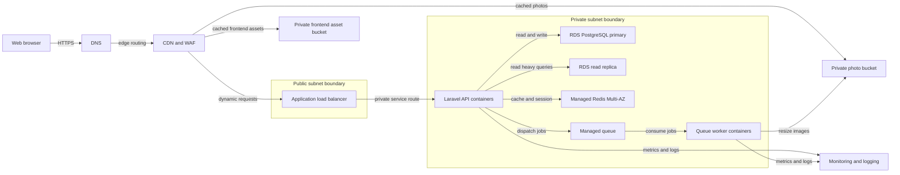

# Arsitektur Infrastruktur LaPak.

Dokumen ini mendeskripsikan target deployment cloud multi-AZ dan jalur evolusi
dari local/single instance menuju sistem yang mampu melayani 500 RPS.

## Status Implementasi

| Komponen | Status |
|---|---|
| SPA auth, Policy, Form Request, rate limit, index DB, upload lokal | Sudah diimplementasi |
| CDN, S3/object storage, Redis, read replica, queue worker, autoscaling, email notification | Rancangan |
| `pg_trgm` + GIN index untuk search | Rancangan; saat ini search memakai `ILIKE` |

## Asumsi dan Hitungan Kapasitas

| Asumsi | Nilai |
|---|---:|
| DAU | 100.000 |
| Request per user per hari | 30 |
| RPS rata-rata | 100.000 x 30 / 86.400 = ~35 |
| Peak factor | 10x |
| Peak RPS | ~350 |
| Target desain | 500 RPS |
| Rasio read:write | 95:5 |
| Listing baru per hari | 100.000 x 2% = 2.000 |
| Foto per listing | 4 |
| Foto per hari | 2.000 x 4 = 8.000 |
| Ukuran foto rata-rata | 330 KB |
| Pertumbuhan foto | 8.000 x 330 KB = ~2,6 GB/hari, ~1 TB/tahun |
| Bandwidth gambar (egress/download) | ~3 MB/user/hari = ~300 GB/hari, sekitar 9 TB/bulan, dilayani CDN |
| Peak photo bandwidth | ~300 Mbps, melalui CDN |

Upload foto sebenarnya sekitar 2,6 GB/hari berdasarkan listing baru dan ukuran
foto. Egress gambar sekitar 300 GB/hari dan wajib dilayani CDN agar bandwidth
origin tidak mengikuti seluruh traffic gambar.

## 1. Diagram Infrastruktur dan Security Boundary

Queue worker dan komponen email notification yang direncanakan belum menjadi
dependency runtime pada implementasi saat ini; keduanya ditampilkan sebagai
target evolusi arsitektur.

Hanya CDN/WAF dan ALB yang menerima traffic publik. Container, database,
Redis, queue, dan worker berada di private subnet tanpa public IP. Object
storage bucket private dan diakses melalui VPC endpoint, workload role, atau
signed URL. Security group hanya mengizinkan ALB ke app, app ke database dan
Redis, serta app atau worker ke queue dan object storage.

Keputusan: managed services dipilih untuk database, Redis, queue, dan object
storage. Alternatifnya self-host semua service dalam VM atau Kubernetes.
Managed services mengurangi pekerjaan patching dan failover, dengan trade-off
biaya bulanan dan lock-in provider.

Secret disimpan di Secrets Manager dan di-inject saat runtime, bukan dimasukkan
ke image container. Database, Redis, dan object storage memakai enkripsi at-rest
dengan KMS; semua koneksi antar tier memakai TLS bila didukung service.

## 2. Scaling dan Reliability

### Autoscaling Policy

- Minimum 2 API containers di dua Availability Zone.
- Scale out saat CPU rata-rata >60% selama 5 menit, memory >70%, atau p95
  latency >400 ms; scale in perlahan setelah 15 menit stabil.
- Worker scale berdasarkan queue depth dan oldest-job age, bukan CPU saja.
- ALB health check memakai endpoint liveness terpisah dari dependency check.
- Read replica menerima query katalog dan detail; write tetap ke primary.
- Connection pooling membatasi koneksi per container agar primary tidak kehabisan
  connection saat autoscaling.

Saat traffic mendadak 10x, CDN menyerap static/image traffic, Redis melayani
hot reads, API autoscaler menambah container, dan queue menunda resize/email.
Jika read replica tertinggal, aplikasi dapat menampilkan data cache sedikit stale.
Redis production dibuat Multi-AZ dengan replica dan failover otomatis. Jika Redis
tetap gagal, cache dapat bypass dan rate limit memakai fallback, tetapi session
SPA hilang sehingga user harus login ulang. Jika object storage gagal, listing
dibuat dengan status `processing` dan retry job.

### Health Check dan Graceful Degradation

| Sinyal | Respons |
|---|---|
| Liveness gagal | ALB mengeluarkan instance dari target |
| Database primary gagal | Endpoint tulis mengembalikan 503; endpoint baca tetap dilayani dari cache atau replica |
| Redis gagal | Bypass cache dan fallback rate limit; session hilang sehingga user login ulang |
| Queue tertunda | Tampilkan processing status, retry exponential backoff |
| CDN miss tinggi | Observability alert, origin tetap protected oleh WAF |

Readiness hanya memeriksa proses dan dependency minimum per instance, bukan
mengeluarkan semua instance hanya karena primary database gagal. Dengan begitu
endpoint baca tetap dapat berjalan saat jalur write sedang dipulihkan.

## 3. Backup dan Recovery

| Komponen | Proteksi | Retensi target |
|---|---|---:|
| PostgreSQL | Automated snapshot harian | 35 hari |
| PostgreSQL | Point in time recovery ke object storage | 35 hari |
| Object storage | Versioning dan lifecycle noncurrent object | 90 hari |
| Object storage | Cross-region replication bila RPO ketat | Sesuai tier |
| Redis | Multi-AZ replica dan failover otomatis; rebuild cache dari source of truth | Session hilang jika seluruh cluster gagal; bukan backup utama |
| Queue | Durable queue dan retry dead letter | 7 hari |

Target recovery:

- RPO database <= 5 menit dengan WAL/PITR.
- RTO database <= 60 menit untuk single-region failure.
- RPO foto <= 15 menit jika replication aktif.
- RTO aplikasi <= 15 menit karena image/container immutable dan autoscaling.

Rencana restore: freeze write, pilih recovery point, restore PostgreSQL ke
staging, jalankan migration compatibility check, verifikasi row count dan
sample listing, lalu promote database dan buka traffic bertahap. Object
storage dipulihkan dari versioning/replica bila object terhapus atau rusak.

Keputusan: PITR dan versioning dipakai sebagai baseline, bukan backup manual
ke laptop. Alternatifnya `pg_dump` dan sinkronisasi cron. Cara manual lebih
murah untuk awal, tetapi recovery point lebih jarang dan restore drill lebih
rentan gagal.

## 4. Monitoring, Alert, dan Logging

### Metrik Utama

- Request rate, error rate 4xx/5xx, p50/p95/p99 latency per route.
- ALB target health, active connections, container CPU/memory, restart count.
- PostgreSQL CPU, storage, connections, locks, replication lag, slow queries.
- Redis hit ratio, memory, evictions, connection count.
- Queue depth, oldest job age, retry count, dead letter count.
- CDN cache hit ratio, origin bandwidth, image 4xx/5xx, WAF blocked requests.
- Business metrics: login success, listing publish success, photo processing time.

### Alert dan Log

Alert high priority untuk 5xx >2%, p95 >1 detik, database unavailable,
replication lag >30 detik, queue oldest job >5 menit, storage >80%, atau
anomaly WAF. Log JSON terstruktur memuat request id, route, status, latency,
user id yang sudah disamarkan, dan error code; jangan log cookie, password,
presigned URL penuh, atau secret. Trace request API ke query database dan job
queue menggunakan correlation id.

## 5. Tahapan Evolusi

| Fase | Arsitektur | Kapan digunakan |
|---|---|---|
| 1. Single instance | Laravel, PostgreSQL, local/S3 storage, queue database | MVP dan traffic kecil |
| 2. Scale-out | CDN, Redis cache/session, object storage, 2 API instances, read replica, managed queue | Mendekati target 100K DAU |
| 3. Specialized scale | Search engine, multi-region read, event pipeline, regional failover | Search/relevance atau latency global menjadi bottleneck |

Migrasi fase dilakukan dengan feature flag dan dual-read terbatas. Search engine
baru dipakai setelah metrik `pg_trgm` menunjukkan latency atau index size tidak
lagi ekonomis; jangan menambah komponen sebelum bottleneck terukur.

Keputusan: multi-region ditunda sampai kebutuhan geografis dan RTO membenarkan
kompleksitas. Alternatifnya active-active sejak awal. Active-active memberi
resilience lebih tinggi, tetapi membutuhkan conflict strategy, global session,
dan data replication yang belum diperlukan untuk MVP.

## 6. Estimasi Biaya Kasar per Bulan

Estimasi berikut adalah perkiraan USD untuk satu region, bukan quotation vendor.
Asumsi: 100K DAU, 500 RPS peak, 1 TB object growth/tahun, egress gambar sekitar
9 TB/bulan, tarif CDN sekitar USD 0,05 - 0,12/GB, satu
primary dan satu read replica, managed services kelas production kecil-menengah.
Biaya egress gambar sangat bergantung pada cache hit ratio dan lokasi pengguna.

| Komponen | Perkiraan per bulan |
|---|---:|
| CDN dan WAF | USD 550 - 1.500 |
| API containers dan ALB | USD 250 - 700 |
| Queue worker containers | USD 75 - 250 |
| PostgreSQL primary managed | USD 300 - 900 |
| Read replica | USD 200 - 700 |
| Redis managed | USD 100 - 350 |
| Object storage 1 TB incremental | USD 25 - 100 |
| Monitoring, logs, backup | USD 100 - 400 |
| **Total perkiraan** | **USD 1.600 - 4.900/bulan** |

Alternatif fase 1 dapat berada di bawah USD 100/bulan pada satu VM kecil,
namun tidak memenuhi reliability, redundancy, dan peak target pada dokumen ini.
Biaya harus divalidasi ulang memakai provider, region, retention, egress, dan
cache hit ratio aktual sebelum production launch.
